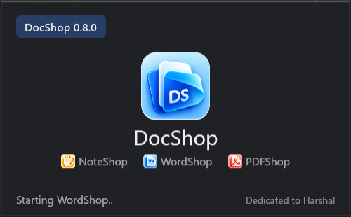
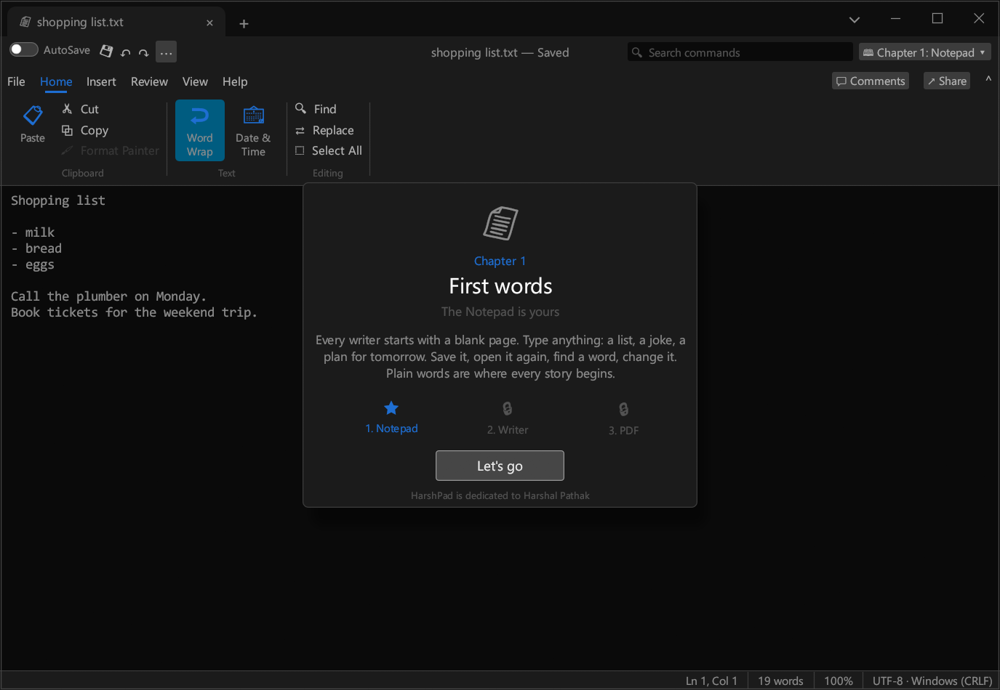
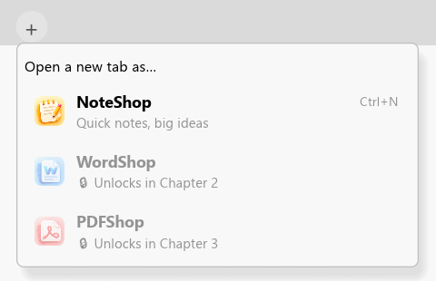
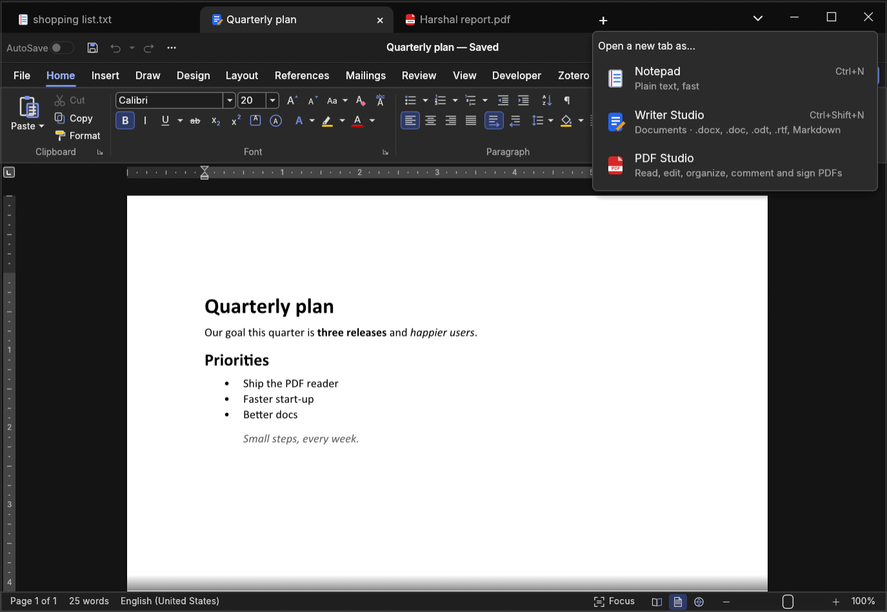
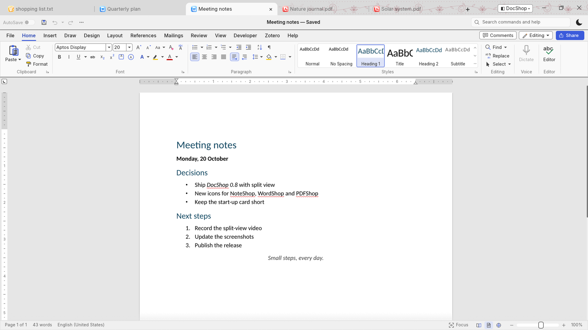
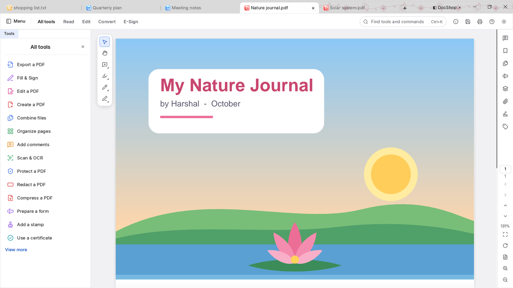

<p align="center">
  
</p>

<h1 align="center">HarshPad Studio</h1>

<p align="center">
  <b>Notepad + Writer Studio + PDF Studio: one suite, one window, browser-style tabs.</b><br>
  Writer Studio is <a href="https://github.com/hvpathak/wordcraft">WordCraft</a>, built in. Plain text, <code>.docx</code>, <code>.doc</code>, <code>.odt</code>, <code>.rtf</code>, Markdown.<br>
  No installer, no account, no telemetry. Windows, macOS and Linux.
</p>

<p align="center">
  <a href="https://github.com/hvpathak/HarshPad/actions/workflows/ci.yml"></a>
  
  
  
  
</p>

<p align="center"><i>Dedicated to my son, <b>Harshal Pathak</b>.</i></p>

<p align="center">
  <a href="#download"><b>⬇ Download</b></a> ·
  <a href="#for-harshal-the-growing-path">📖 The growing path</a> ·
  <a href="#one-app-four-modes">🎛 Modes</a> ·
  <a href="#writer-studio">✍️ Writer Studio</a> ·
  <a href="#the-notepad">📄 Notepad</a> ·
  <a href="#fast-measured">⚡ Speed</a> ·
  <a href="#roadmap">🚀 Roadmap</a>
</p>

<p align="center">
  
</p>

<p align="center">
  <br>
  <sub>HarshPad opens as a small start-up card, then grows to where you left the window last time.</sub>
</p>

---

## For Harshal: the growing path

HarshPad was made for my son, Harshal. It is built to grow up with him, one chapter at a time.

**Chapter 1 · First words.** It starts as a plain notepad. No fonts, no buttons he doesn't need: just a
blank page where he can type a list, a joke or a plan for tomorrow, save it, and find it again.

**Chapter 2 · Stories with style.** When he's ready, a parent unlocks the Writer. His words get titles,
headings, colours and lists: a story, a school report, a letter. The notepad stays right beside it.

**Chapter 3 · Real papers.** Later the PDF chapter opens: forms, books and certificates to read, search,
put in order and sign.

Each chapter keeps everything from the one before, and it works the same on Windows, macOS and Linux.

<p align="center">
  
  
</p>

**How to use it:** top right **◧ → 📖 Start the growing path…**, choose a parent PIN, and HarshPad
becomes Chapter 1. The **+** menu shows the apps still to come, locked. When it's time, a parent picks
**🔑 Unlock Chapter 2** and types the PIN; a new chapter card opens. **🚪 Leave the growing path** (also
behind the PIN) turns it off.

Where each chapter stands on its way to 100% of the projects we follow: **[Road to 100%](docs/parity.md)**.

## Three apps, one window, browser-style tabs

<p align="center">
  
</p>

- **+ asks which app:** Notepad, Writer Studio or PDF Studio, always those three (<kbd>Ctrl+T</kbd>). One a mode
  switches off shows greyed out; on Harshal's growing path a locked one says which chapter unlocks it.
- **Tabs live in the title bar**, each with its app's colour icon. Drag to reorder, middle-click or <kbd>Ctrl+W</kbd> to
  close, <kbd>Ctrl+Tab</kbd> to cycle, <kbd>Ctrl+1</kbd>…<kbd>Ctrl+8</kbd> to jump. A dot marks unsaved work.
- **Split view, like a web browser:** right-click a tab → *Split view with…* to put two tabs of the same kind
  (two documents, two PDFs, two notes) side by side. Click a side to work in it (blue outline); drag the
  middle to resize; the × in a side's bottom-right corner takes it out of the split.
- **Close the last tab** and the window asks what to open next: Notepad, Writer Studio, PDF Studio or a file.
  <kbd>Ctrl+Shift+T</kbd> brings the last closed tab back, unsaved text included.
- **Indian border art** (paisleys and lotuses) runs along the title bar, gold on dark and maroon on light.
- **Each tab shows only its own app.** A Notepad tab has the Notepad's tools; a Writer Studio tab has the full
  word-processor ribbon; a PDF Studio tab has the PDF tools. Nothing mixes.

## One app, four modes

| Mode | What you get |
|---|---|
| **All together (Studio)** | Notepad, Writer Studio and PDF Studio side by side in tabs |
| **Notepad only** | The fast, distraction-free plain-text editor, nothing else |
| **Writer Studio only** | Just the word processor: perfect for students and kids |
| **PDF Studio only** | Just the PDF tools |

Switch from the **◧** button at the top right. A **parent lock** keeps the app in one mode behind a 4–8 digit PIN,
so a child can use the Writer without wandering into anything else. A file whose app is switched off in the
current mode says so instead of opening.

## Writer Studio

<p align="center">
  
</p>

Every Writer Studio tab is **[WordCraft](https://github.com/hvpathak/wordcraft)**, the open-source word
processor, running inside HarshPad. That's the whole of it, not a subset: the full ribbon and command
catalog, styles and themes, tables, page layout and sections, headers and footers, footnotes,
references and citations, comments, track changes, compare, proofing, mail merge, pictures, shapes,
charts, SmartArt, equations and drawing, with native open/save dialogs, printing, the rich clipboard,
crash recovery and your own dictionary and fonts.

It opens .docx, .doc, .rtf, .odt, .html and Markdown, and saves those plus PDF. HarshPad adds
the browser-style tabs, so a document, a plain-text note and a PDF sit side by side in one window.
WordCraft is pinned to an exact version on the `harshpad` branch of [our fork](https://github.com/hvpathak/wordcraft),
which adds HarshPad's touches: Help and Feedback go to this project, no community or account buttons, and a
☀/☾ light/dark switch. New WordCraft releases come in with one command, `scripts/get-their-update.ps1`.

## PDF Studio

<p align="center">
  
</p>

Every PDF Studio tab is **[PdfCraft](https://github.com/hvpathak/pdfcraft)**, the open-source PDF editor, running
inside HarshPad: read with sharp zoom, search and copy text; edit text and images; organize, insert, extract,
split and combine pages; comment and highlight; fill and sign forms; create, export and compress PDFs; protect,
redact, OCR and more. Its own tab strip steps aside for HarshPad's tabs (one PDF per tab), it keeps its light/dark
button, and Help goes to this project. It comes from the `harshpad` branch of
[our fork](https://github.com/hvpathak/pdfcraft), updated the same way as the Writer.

## The Notepad

<p align="center">
  
</p>

Everything the classic notepad does, with guarantees it never had:

- **Never loses your text:** atomic saves, a prompt before closing unsaved work, and **crash recovery**
  (unsaved tabs are kept every 30 seconds and come back after a crash).
- **Encodings done right:** UTF-8, UTF-8 BOM, UTF-16 LE/BE; CRLF and LF kept byte for byte.
- **No crashes by design:** `unwrap`, `panic!`, raw indexing and `unsafe` are banned by the compiler in app code.
- Find/Replace, word wrap, zoom, status bar, drag and drop, the shortcuts your hands know.

## One rhythm across every tab

The same layout everywhere: **tabs · quick-access row · ribbon**, and the same status bar
(position · words · zoom · format). Each mode shows only the ribbon tabs it uses: Notepad mode keeps
File, Home, Insert, Review, View and Help. Every action lives in one command catalog, so the same key does the
same thing in every tab and no key means two things. <kbd>Ctrl+Shift+P</kbd> opens the command palette.

## Fast, measured

On a mid-range laptop (i5-13450HX), release build:

| | |
|---|---|
| Notepad: CLI, 200,000 replacements in a 10.7 MB file | **149 ms** |
| App size and start-up with the Writer built in | measured again for v0.6 |

## Download

| Platform | Download | Notes |
|---|---|---|
| **Windows** 10 / 11 (x64) | [HarshPad-windows-x64.exe](https://github.com/hvpathak/HarshPad/releases/latest/download/HarshPad-windows-x64.exe) | One file, double-click. If SmartScreen warns, choose **More info → Run anyway**. |
| **macOS** 11+ (Apple Silicon **and** Intel) | [HarshPad-macos-universal.zip](https://github.com/hvpathak/HarshPad/releases/latest/download/HarshPad-macos-universal.zip) | Unzip, drag to Applications. First launch: right-click → **Open**. |
| **Linux** x64 | [HarshPad-linux-x64.tar.gz](https://github.com/hvpathak/HarshPad/releases/latest/download/HarshPad-linux-x64.tar.gz) | Unpack and run `./harshpad`. Needs GTK 3 (on most desktops already). |

Command-line tool: [Windows](https://github.com/hvpathak/HarshPad/releases/latest/download/harshpad-cli-windows-x64.exe) ·
[macOS](https://github.com/hvpathak/HarshPad/releases/latest/download/harshpad-cli-macos-universal.zip) · Linux (inside the tarball).

## The CLI

```text
harshpad-cli convert notes.md report.docx          # .txt .md .docx .hpdoc, any to any
harshpad-cli words essay.docx                      # word and character count
harshpad-cli replace notes.txt "teh" "the"         # replace all, saved atomically
harshpad-cli info notes.txt                        # encoding, line endings, lines
harshpad-cli commands                              # every command, menu and shortcut
```

## Build from source

```sh
git clone https://github.com/hvpathak/HarshPad
cd HarshPad
cargo run --release -p harshpad
cargo test --workspace
```

Rust 1.95+. On Linux, install GTK 3 and xkbcommon headers first
(`sudo apt install libgtk-3-dev libxkbcommon-dev libxcb-render0-dev libxcb-shape0-dev libxcb-xfixes0-dev`).

## How it's built

```text
crates/core     commands (one catalog for every tab kind), modes, plain-text documents, find, undo
crates/rich     rich documents: styled-text model, .docx (from the public ECMA-376 standard), Markdown, .hpdoc
crates/layout   page layout for the built-in document view
apps/harshpad   the desktop app: browser-style tabs, the Notepad, and Writer tabs hosting WordCraft
apps/harshpad-cli  the same engines from the command line
```

- **Engine first:** all editing logic lives in libraries with no UI code, tested headlessly (50+ tests).
- **Built on WordCraft:** the Writer is WordCraft's editor and its desktop services, used under its open-source
  license (MIT OR Apache-2.0) and pinned by git revision; see [licenses](licenses/README.md).
- **Following upstream:** a weekly [radar](docs/upstream.md) watches the projects we build on, and moving to a new
  WordCraft version is a one-line change, tested on every platform.

## Roadmap

Full area-by-area tracker: **[Road to 100%](docs/parity.md)**.

- **Writer Studio:** done (WordCraft). Next: the agent control channel.
- **PDF Studio:** done (PdfCraft).

Ideas and pull requests are welcome. The house rules: no `unwrap`/`panic`/`unsafe` outside tests,
and every change comes with a test.

## License

[MIT](LICENSE). The built-in Writer is WordCraft (MIT OR Apache-2.0); its license texts and NOTICE are in
[licenses/wordcraft](licenses/wordcraft). PDF Studio is PdfCraft (MIT OR Apache-2.0); see [licenses/pdfcraft](licenses/pdfcraft).
HarshPad is an independent project.
