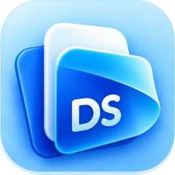

<p align="center">
  
</p>

<h1 align="center">HarshPad</h1>

<p align="center">
  <b>The notepad you already know, rebuilt from scratch in Rust.</b><br>
  Opens in ~30 ms. One small app. No installer, no account, no telemetry, no crashes by design.<br>
  Windows, macOS and Linux.
</p>

<p align="center">
  <a href="https://github.com/hvpathak/HarshPad/actions/workflows/ci.yml"></a>
  
  
  
  
</p>

<p align="center">
  <a href="#download"><b>⬇ Download</b></a> ·
  <a href="#why-harshpad">✨ Why</a> ·
  <a href="#fast-measured">⚡ Speed</a> ·
  <a href="#the-cli">🤖 CLI</a> ·
  <a href="#coming-next-harshpad-studio">🚀 Next</a>
</p>

<p align="center">
  
</p>

---

## Why HarshPad?

The notepad is the one app everyone opens every day. HarshPad keeps everything your hands already know,
and adds the guarantees a text editor should always have had.

<table>
  <tr>
    <td width="50%" valign="top">
      <h3>⚡ Instant</h3>
      The window is up in about <b>30 ms</b> (warm start). Big files open without freezing: the editor refuses
      anything over 64 MB politely instead of locking up.
    </td>
    <td width="50%" valign="top">
      <h3>🛡️ Never loses your text</h3>
      Saves are <b>atomic</b>: HarshPad writes a temporary file and swaps it in, so a full disk or a power cut
      can't leave you with half a file. Closing with unsaved changes always asks first.
    </td>
  </tr>
  <tr>
    <td valign="top">
      <h3>🦀 No crashes by design</h3>
      <code>unwrap</code>, <code>panic!</code>, raw indexing and <code>unsafe</code> are banned by the compiler in all
      app code. Every damaged file or odd input becomes a message you can act on.
    </td>
    <td valign="top">
      <h3>🔤 Encodings done right</h3>
      UTF-8, UTF-8 with BOM, UTF-16 LE and BE. CRLF and LF line endings are detected and written back
      <b>byte for byte</b>.
    </td>
  </tr>
  <tr>
    <td valign="top">
      <h3>⌨️ Zero learning curve</h3>
      The menus and shortcuts you know: <kbd>Ctrl+N/O/S</kbd>, <kbd>Ctrl+Shift+S</kbd>, <kbd>Ctrl+F</kbd>,
      <kbd>F3</kbd> / <kbd>Shift+F3</kbd>, <kbd>Ctrl+H</kbd>, <kbd>Ctrl++/−/0</kbd>, Word Wrap, Status Bar.
    </td>
    <td valign="top">
      <h3>🔒 Private</h3>
      No network code at all. Nothing is sent anywhere, ever. Your fonts come from your own computer.
    </td>
  </tr>
</table>

## Fast, measured

Measured on a mid-range laptop (i5-13450HX), release build:

| | |
|---|---|
| Window open (warm start) | **~30 ms** |
| App size | **4.6 MB**, a single file |
| CLI: 200,000 replacements in a 10.7 MB file | **149 ms** |

## Download

| Platform | Download | Notes |
|---|---|---|
| **Windows** 10 / 11 (x64) | [HarshPad-windows-x64.exe](https://github.com/hvpathak/HarshPad/releases/latest/download/HarshPad-windows-x64.exe) | One file, double-click. If SmartScreen warns, choose **More info → Run anyway**. |
| **macOS** 11+ (Apple Silicon **and** Intel) | [HarshPad-macos-universal.zip](https://github.com/hvpathak/HarshPad/releases/latest/download/HarshPad-macos-universal.zip) | Unzip, drag to Applications. First launch: right-click → **Open**. |
| **Linux** x64 | [HarshPad-linux-x64.tar.gz](https://github.com/hvpathak/HarshPad/releases/latest/download/HarshPad-linux-x64.tar.gz) | Unpack and run `./harshpad`. Needs GTK 3 (on most desktops already). |

Command-line tool: [Windows](https://github.com/hvpathak/HarshPad/releases/latest/download/harshpad-cli-windows-x64.exe) ·
[macOS](https://github.com/hvpathak/HarshPad/releases/latest/download/harshpad-cli-macos-universal.zip) · Linux (inside the tarball).

Open a file directly: `harshpad notes.txt` (a missing file starts empty and saves to that name).
Drag a file onto the window to open it.

## Shortcuts

| Action | Shortcut |
|---|---|
| New / Open / Save | <kbd>Ctrl+N</kbd> / <kbd>Ctrl+O</kbd> / <kbd>Ctrl+S</kbd> |
| Save As | <kbd>Ctrl+Shift+S</kbd> |
| Find / Replace | <kbd>Ctrl+F</kbd> / <kbd>Ctrl+H</kbd> |
| Find Next / Previous | <kbd>F3</kbd> / <kbd>Shift+F3</kbd> |
| Zoom in / out / reset | <kbd>Ctrl++</kbd> / <kbd>Ctrl+−</kbd> / <kbd>Ctrl+0</kbd> |
| Undo / Redo / Select all | <kbd>Ctrl+Z</kbd> / <kbd>Ctrl+Y</kbd> / <kbd>Ctrl+A</kbd> |

## The CLI

The same engine without a window, for scripts and AI agents:

```text
harshpad-cli info notes.txt                              # encoding, line endings, lines, characters
harshpad-cli replace notes.txt "teh" "the" --match-case  # replace all, saved atomically
harshpad-cli commands                                    # every command, its menu and shortcut
```

## Build from source

```sh
git clone https://github.com/hvpathak/HarshPad
cd HarshPad
cargo run --release -p harshpad
cargo test --workspace
```

Rust 1.88+. On Linux, install GTK 3 and xkbcommon headers first
(`sudo apt install libgtk-3-dev libxkbcommon-dev libxcb-render0-dev libxcb-shape0-dev libxcb-xfixes0-dev`).

## How it's built

```text
crates/core        the engine: documents, encodings, find/replace, the command catalog (no UI code)
apps/harshpad      the desktop app: a thin egui shell that draws the engine's state
apps/harshpad-cli  the same engine from the command line
```

- **Everything is a command.** Menus, shortcuts and the CLI are all generated from one catalog.
- **Tests are the gate.** Encodings round-trip byte for byte, malformed files can't panic, find/replace is
  tested on non-ASCII text, and CI runs everything on Windows, macOS and Linux.
- **Clean-room.** Written from scratch by observing how the classic notepad behaves. No code, icons or
  assets were copied.

## Coming next: HarshPad Studio

HarshPad is growing into one app for **plain text, rich documents and PDFs**, all in tabs that work the same way:

- **Write:** headings, bold/italic/underline, colours, lists, links; open and save `.docx` and Markdown.
- **Read PDFs:** sharp at any zoom, thumbnails, search, copy text.
- **Organize PDFs:** rotate, delete, reorder, merge, split, extract pages.
- **Comment and sign:** highlights, notes, ink, signatures; export any document to PDF.

Ideas and pull requests are welcome. The house rules: no `unwrap`/`panic`/`unsafe` outside tests,
and every change comes with a test.

## License

[MIT](LICENSE). HarshPad is an independent project.
