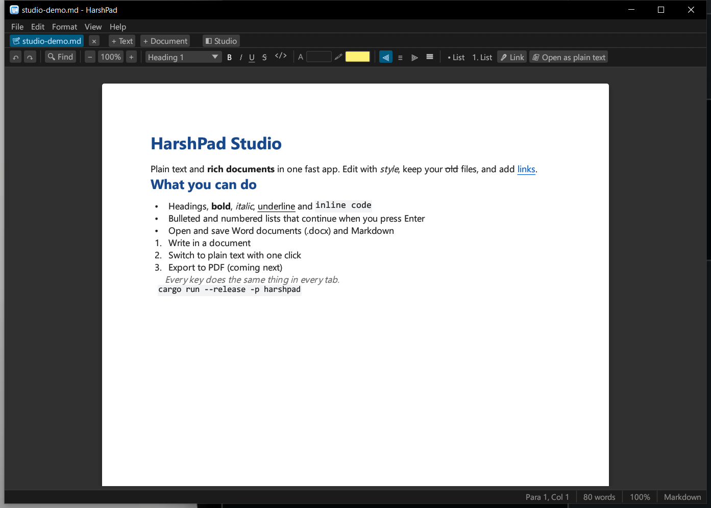
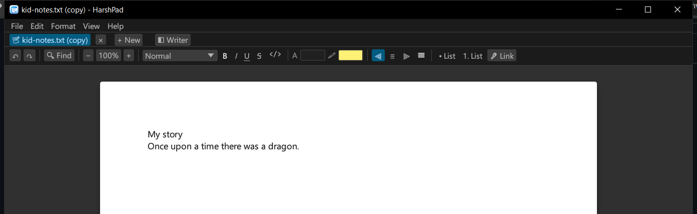
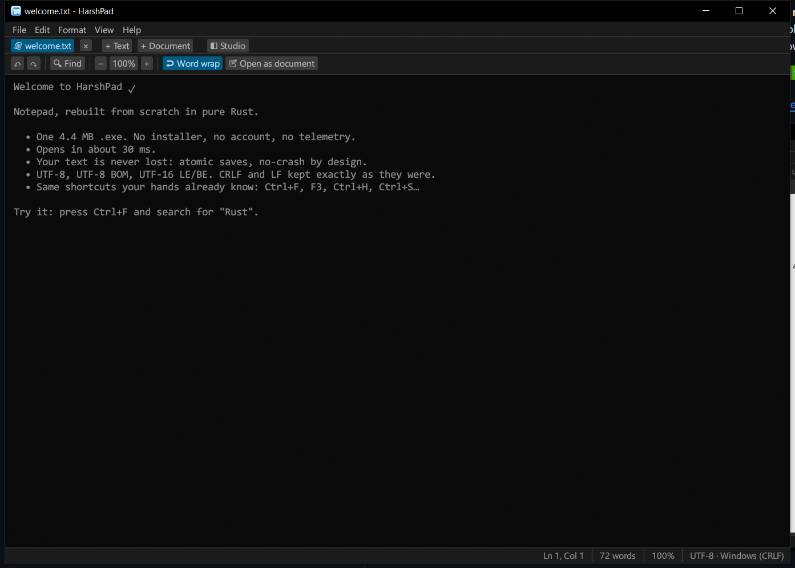

<p align="center">
  
</p>

<h1 align="center">HarshPad Studio</h1>

<p align="center">
  <b>A notepad, a writer and (soon) a PDF tool, in one fast app that moves to one rhythm.</b><br>
  Plain text and rich documents in tabs · <code>.docx</code> · Markdown · one toolbar, one set of shortcuts.<br>
  Opens in ~30 ms. No installer, no account, no telemetry. Windows, macOS and Linux.
</p>

<p align="center">
  <a href="https://github.com/hvpathak/HarshPad/actions/workflows/ci.yml"></a>
  
  
  
  
</p>

<p align="center">
  <a href="#download"><b>⬇ Download</b></a> ·
  <a href="#one-app-four-modes">🎛 Modes</a> ·
  <a href="#the-writer">✍️ Writer</a> ·
  <a href="#the-notepad">📄 Notepad</a> ·
  <a href="#fast-measured">⚡ Speed</a> ·
  <a href="#roadmap">🚀 Roadmap</a>
</p>

<p align="center">
  
</p>

---

## One app, four modes

| Mode | What you get |
|---|---|
| **All together (Studio)** | Text files and rich documents side by side in tabs, with one-click conversion between them |
| **Notepad only** | The fast, distraction-free plain-text editor, nothing else |
| **Writer only** | Just the document writer: perfect for students and kids |
| **PDF only** | Coming in the next release |

<p align="center">
  
</p>

Switch from the **◧** button next to the tabs (or *View → Mode*). A **parent lock** keeps the app in one
mode behind a 4–8 digit PIN, so a child can use the Writer without wandering into anything else.
Files of another kind open as a new copy in the current mode, so nothing on disk is ever overwritten
in a different format.

## The Writer

| | |
|---|---|
| ✍️ **Styles** | Title, Heading 1–3, Quote, Code block, bulleted and numbered lists (Enter continues a list; Enter on an empty item ends it) |
| 🅱️ **Formatting** | Bold, italic, underline, strikethrough, inline code, font size, text colour, highlight, links, alignment, clear formatting |
| ⚡ **Markdown shortcuts** | Type `- `, `1. `, `# `, `## `, `> ` at the start of a line and it becomes a list, heading or quote |
| 📂 **Files** | Open and save `.docx`, Markdown, and the lossless `.hpdoc` format |
| 🔍 **Find & Replace** | Works across styles; replacing keeps each match's formatting |
| 🔁 **Sync** | *Open as plain text* turns any document into Markdown; *Open as document* turns Markdown into formatting |

Shortcuts you already know: <kbd>Ctrl+B/I/U</kbd>, <kbd>Ctrl+L/E/R/J</kbd> to align, <kbd>Ctrl+Alt+1/2/3</kbd> headings,
<kbd>Ctrl+Alt+0</kbd> normal text, <kbd>Ctrl+Shift+L</kbd> bullets, <kbd>Ctrl+K</kbd> link, <kbd>Ctrl+]</kbd>/<kbd>Ctrl+[</kbd> size,
<kbd>Ctrl+Space</kbd> clear formatting.

## The Notepad

<p align="center">
  
</p>

Everything the classic notepad does, with guarantees it never had:

- **Never loses your text:** atomic saves, a prompt before closing unsaved work, and **crash recovery**
  (unsaved tabs are kept every 30 seconds and come back after a crash).
- **Encodings done right:** UTF-8, UTF-8 BOM, UTF-16 LE/BE; CRLF and LF kept byte for byte.
- **No crashes by design:** `unwrap`, `panic!`, raw indexing and `unsafe` are banned by the compiler in app code.
- Find/Replace, word wrap, zoom, status bar, drag and drop, the shortcuts your hands know.

## One rhythm across every tab

The same layout everywhere: **undo · find · zoom · tools for this tab**, and the same status bar
(position · words · zoom · format). Every action lives in one command catalog, so the same key does the
same thing in every tab and no key means two things. <kbd>Ctrl+Shift+P</kbd> opens the command palette.

## Fast, measured

On a mid-range laptop (i5-13450HX), release build:

| | |
|---|---|
| Window open (warm start) | **~30 ms** |
| Memory with a document open | **~76 MB** |
| App size | **5.7 MB**, a single file |
| CLI: 200,000 replacements in a 10.7 MB file | **149 ms** |

## Download

| Platform | Download | Notes |
|---|---|---|
| **Windows** 10 / 11 (x64) | [HarshPad-windows-x64.exe](https://github.com/hvpathak/HarshPad/releases/latest/download/HarshPad-windows-x64.exe) | One file, double-click. If SmartScreen warns, choose **More info → Run anyway**. |
| **macOS** 11+ (Apple Silicon **and** Intel) | [HarshPad-macos-universal.zip](https://github.com/hvpathak/HarshPad/releases/latest/download/HarshPad-macos-universal.zip) | Unzip, drag to Applications. First launch: right-click → **Open**. |
| **Linux** x64 | [HarshPad-linux-x64.tar.gz](https://github.com/hvpathak/HarshPad/releases/latest/download/HarshPad-linux-x64.tar.gz) | Unpack and run `./harshpad`. Needs GTK 3 (on most desktops already). |

Command-line tool: [Windows](https://github.com/hvpathak/HarshPad/releases/latest/download/harshpad-cli-windows-x64.exe) ·
[macOS](https://github.com/hvpathak/HarshPad/releases/latest/download/harshpad-cli-macos-universal.zip) · Linux (inside the tarball).

## The CLI

```text
harshpad-cli convert notes.md report.docx          # .txt .md .docx .hpdoc, any to any
harshpad-cli words essay.docx                      # word and character count
harshpad-cli replace notes.txt "teh" "the"         # replace all, saved atomically
harshpad-cli info notes.txt                        # encoding, line endings, lines
harshpad-cli commands                              # every command, menu and shortcut
```

## Build from source

```sh
git clone https://github.com/hvpathak/HarshPad
cd HarshPad
cargo run --release -p harshpad
cargo test --workspace
```

Rust 1.88+. On Linux, install GTK 3 and xkbcommon headers first
(`sudo apt install libgtk-3-dev libxkbcommon-dev libxcb-render0-dev libxcb-shape0-dev libxcb-xfixes0-dev`).

## How it's built

```text
crates/core     commands (one catalog for every tab kind), modes, plain-text documents, find, undo
crates/rich     rich documents: styled-text model, .docx (from the public ECMA-376 standard), Markdown, .hpdoc
apps/harshpad   the desktop app: tabs, the shared toolbar and status bar, Notepad and Writer views
apps/harshpad-cli  the same engines from the command line
```

- **Engine first:** all editing logic lives in libraries with no UI code, tested headlessly (50+ tests).
- **Clean-room:** behaviour is studied, never copied. `.docx` support is written from the public standard.
- **Following upstream:** a weekly [radar](docs/upstream.md) reads the public feature notes of the open-source
  writer and PDF projects we track (never their code) and opens an issue for anything new; library updates
  arrive through Dependabot and are tested on every platform.

## Roadmap

- **PDF** (next): read with sharp zoom, thumbnails, search, copy text; rotate, delete, reorder, merge, split pages.
- **Comment & sign:** highlights, notes, ink, signatures; export any document to PDF with page numbers.
- **Writer:** tables, images, headers and footers, spelling.

Ideas and pull requests are welcome. The house rules: no `unwrap`/`panic`/`unsafe` outside tests,
and every change comes with a test.

## License

[MIT](LICENSE). HarshPad is an independent project.
